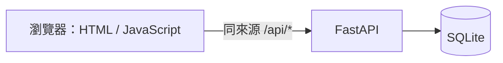

# 04 SAD — ＜專案名稱＞

> 上游 PRD/SRS；技術依 `course/01-上課/04-STACK.md`。只描述本次需要的邊界。

## 系統圖

圖為課程技術邊界，根據實際 SDS 修訂；驗證與存檔各由誰負責：＜＞。

## 模組責任與失敗
＜輸入如何被驗證、錯誤如何回到畫面、資料庫失敗時怎麼處理＞。

## 必要取捨（有真正替代方案才寫）
＜選擇、替代方案、理由；沒有新決策可明記沿用 STACK，不硬湊 ADR＞。

通過條件：元件責任清楚、沒有多出範圍外服務；每條必要需求在此或 SDS 有落點。
