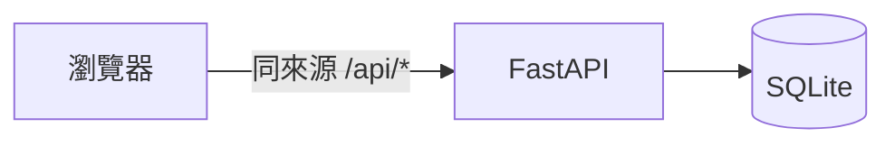

# 04 SAD — ＜專案名稱＞

> 用途：說明系統邊界、責任與設計取捨。上游 PRD/SRS；技術限制依 [STACK](../04-STACK.md)。記錄版本、狀態與審查者。

## 情境與品質驅動

列最重要的使用者路徑、資料敏感性、故障影響及相關 NFR。說明課堂環境與預期部署環境；部署不在範圍時明記。

## 元件與資料流

按實際設計修訂。標示信任邊界、輸入驗證點、資料寫入／讀取方向，外部依賴與失敗時回饋。

圖後用幾段短文沿主要資料流說明：輸入在哪裡驗證、誰負責計算與存檔、失敗怎麼回到使用者。需要點名元件時用列點：

- **＜元件＞：**負責＜＞，擁有＜資料＞，透過＜介面＞依賴＜元件＞。失敗時＜處置＞。對應 FR／NFR：＜＞。

## 重要決策與取捨

### ＜決策名稱；必要時編 ADR-01＞

**決定：**＜採用什麼及理由＞。**考慮過：**＜真正可能採用的替代方案及其代價＞。**影響與驗證：**＜受影響需求、如何確認取捨可接受＞。

STACK 已固定的選型可直接引用；沒有新決策不硬湊 ADR。

## 運作、風險與未決

說明資料備份／恢復、可觀察錯誤、啟動與設定、變更回退中與本次風險相關者；課堂主線不部署時標「不適用：本次只在本機執行」，並記錄若正式上線需補的工作。列待決項及決策人。

**Gate：** 每個元件有責任；信任與資料邊界清楚；關鍵失敗模式有對策；取捨和需求相容；沒有聲稱未驗證的上線能力。
