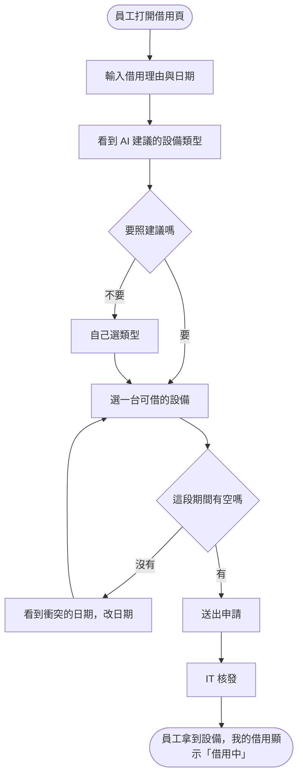

# 02 PRD —— IT 設備借用平台

| 項目 | 內容 |
|---|---|
| 版本 | v0.1 |
| 上游 | `01-brief.md` v0.1 |
| 最後更新 | 2026-10-16 |

---

## 1. Persona

| 編號 | 是誰 | 處境與習慣 | 最怕什麼 |
|---|---|---|---|
| P-01 | 業務部的小林 | 每月 2–3 次要借筆電或投影機去客戶那裡，常在出發前一小時才想到 | 到了現場才發現沒借到 |
| P-02 | IT 管理員阿德 | 一個人管 200 台設備，同時要處理報修 | 盤點時對不上數字被主管問 |

---

## 2. User Flow

---

## 3. Epic 與 User Story

### EP-01 自助借用（對應 G-01）

| 編號 | 身為 | 我想要 | 以便 | 優先 |
|---|---|---|---|---|
| US-01 | P-01 | 輸入理由後看到建議的設備類型 | 不用自己猜要借什麼 | 加分 |
| US-02 | P-01 | 選日期後立刻知道某台設備借不借得到 | 不用等 IT 回覆 | 必要 |
| US-03 | P-01 | 看到我目前借了什麼、何時要還 | 不會忘記歸還 | 必要 |

### EP-02 設備去向（對應 G-02、G-03）

| 編號 | 身為 | 我想要 | 以便 | 優先 |
|---|---|---|---|---|
| US-04 | P-02 | 核發與登記歸還 | 每台設備都有明確的持有人 | 必要 |
| US-05 | P-02 | 看到逾期未還的清單 | 主動追回 | 必要 |

---

## 4. 驗收條件（BDD）

### US-01 建議設備類型

- **AC-01.1** Given 員工輸入理由「下週去客戶那邊簡報」 When 按「建議」 Then 3 秒內看到一個建議類型（筆電或投影機其中之一）與一句理由
- **AC-01.2** Given 建議功能無法使用 When 按「建議」 Then 看到「暫時無法建議，請自己選類型」，而且仍然可以繼續申請

### US-02 即時知道借不借得到

- **AC-02.1** Given 筆電 NB-07 在 10/20–10/22 已被借出 When 員工選 NB-07、日期 10/21 Then 看到「NB-07 在 10/20–10/22 已被借出」且無法送出
- **AC-02.2** Given NB-08 在 10/21 沒有任何借用 When 員工選 NB-08、日期 10/21 並送出 Then 看到「申請已送出，等待 IT 核發」
- **AC-02.3** Given 員工選的歸還日比借用日早 When 送出 Then 看到「歸還日不能早於借用日」且沒有建立申請

### US-03 我的借用

- **AC-03.1** Given 員工有一筆核發中的借用，歸還日 10/22 When 打開「我的借用」 Then 看到該設備編號、狀態「借用中」、歸還日 10/22

### US-04 核發與歸還

- **AC-04.1** Given 一筆「待核發」的申請 When IT 按「核發」 Then 狀態變成「借用中」，持有人是申請的員工
- **AC-04.2** Given 一筆「借用中」的借用 When IT 按「登記歸還」 Then 狀態變成「已歸還」，該設備在同一段日期可以再被申請

### US-05 逾期清單

- **AC-05.1** Given 今天 10/25，一筆借用歸還日是 10/22 且未歸還 When IT 打開逾期清單 Then 看到這筆，顯示逾期 3 天
- **AC-05.2** Given 一筆借用歸還日是 10/25 When 今天 10/25 打開逾期清單 Then 不出現這筆

---

## 5. AI 的角色與限制

| AI 可以 | AI 不可以 |
|---|---|
| 依借用理由建議設備**類型** | 指定哪一台、判斷有沒有空、核發、改狀態 |

**AI 出錯時使用者怎麼辦**：建議只是預設值，員工可以改；建議功能壞掉時照樣能申請（AC-01.2）。

---

## 6. 待決事項

| 編號 | 問題 | 誰決定 | 什麼情況下會知道答案 |
|---|---|---|---|
| Q-01 | 同一個人可以同時借兩台筆電嗎 | IT 主管 | 下週 IT 例會 |
