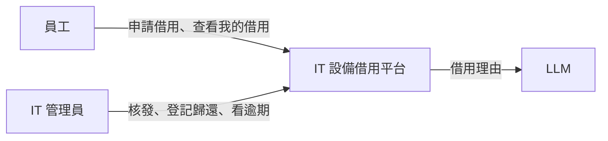
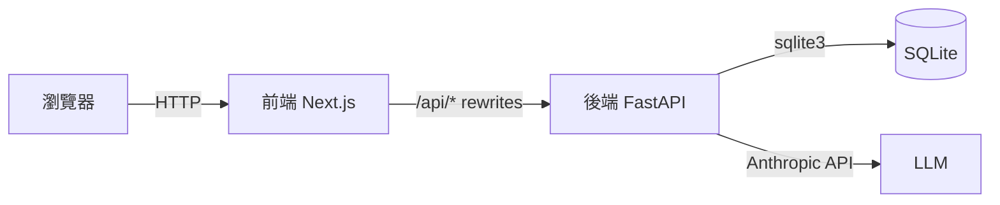
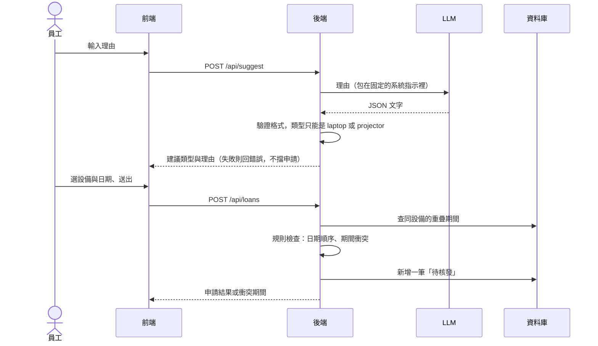

# 04 SAD —— IT 設備借用平台

| 項目 | 內容 |
|---|---|
| 版本 | v0.1 |
| 上游 | `03-srs.md` v0.1 |
| 最後更新 | 2026-10-16 |

---

## 1. C4 Level 1：系統情境

---

## 2. C4 Level 2：容器

---

## 3. 資訊流：申請借用

---

## 4. 誰負責什麼

| 工作 | 負責 | 理由 | 對應需求 |
|---|---|---|---|
| 依理由建議類型 | 🤖 AI | 理由是自由文字，規則寫不完；錯了員工可以改 | FR-01 |
| 判斷期間衝突、日期順序 | 📏 程式碼 | 錯了就會兩個人借到同一台 | FR-03、FR-04 |
| 狀態轉換 | 📏 程式碼 | 狀態錯了，設備就找不到持有人 | FR-07 |
| 核發 | 👤 人 | 實際把設備交出去的是 IT | FR-07 |

---

## 5. 技術選型（ADR）

| 編號 | 決定 | 放棄的選項 | 理由 | 可逆嗎 | 對應需求 |
|---|---|---|---|---|---|
| ADR-01 | 建議與申請是兩支 API，建議失敗不影響申請 | 一支 API 一次做完 | AI 失敗不能讓核心流程停擺 | 可逆 | FR-02、NFR-03 |
| ADR-02 | 期間衝突在後端查資料庫判斷，前端只顯示結果 | 前端先過濾可借設備 | 兩個人同時申請時，只有後端看得到全貌 | 可逆 | FR-03 |
| ADR-03 | 狀態用三個固定值，存成文字 | 用多個布林欄位 | 三個值才能用 FR-07 的順序規則檢查 | ⚠️ 不可逆（要搬資料） | FR-07 |

---

## 6. 安全與紅線

| 紅線 | 用什麼擋 | 對應需求 |
|---|---|---|
| 理由欄不能讓 AI 指定設備或改狀態 | AI 輸出的 schema 只有 `type` 與 `reason` 兩個欄位，其他欄位一律丟掉；狀態只由核發、歸還兩支 API 改 | NFR-02 |
| AI 回傳亂碼不能影響申請 | 建議 API 驗證失敗就回錯誤；申請 API 完全不呼叫 AI | NFR-03 |
