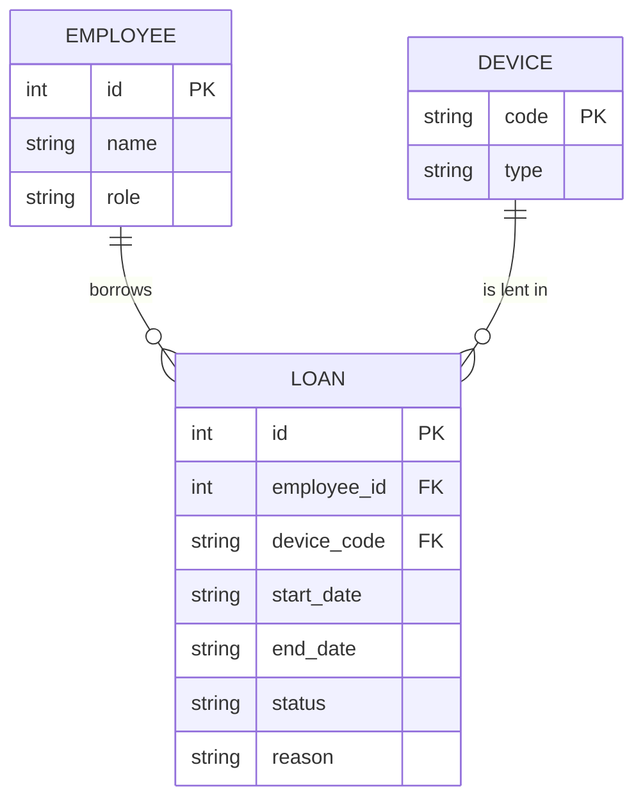

# 05 SDS —— IT 設備借用平台

| 項目 | 內容 |
|---|---|
| 版本 | v0.1 |
| 上游 | `04-sad.md` v0.1 |
| 最後更新 | 2026-10-16 |

---

## 1. ER Model

| 表 | 欄位 | 型別 | 允許的值 / 預設 | 對應需求 |
|---|---|---|---|---|
| device | type | text | `laptop`、`projector` | FR-01 |
| loan | status | text | `pending`、`lent`、`returned`；預設 `pending` | FR-05、FR-07 |
| loan | reason | text | 員工原本輸入的理由，原文保存 | NFR-02 |
| employee | role | text | `employee`、`it` | FR-07 |

---

## 2. API 規格

### API-01 `POST /api/suggest`

| 項目 | 內容 |
|---|---|
| 用途 | 依理由建議設備類型（只建議，不存檔） |
| 對應需求 | FR-01、FR-02 |
| Request | `{"reason": "string"}` |
| Response 200 | `{"type": "laptop" \| "projector", "why": "string"}` |

| 錯誤情況 | 狀態碼 | 回傳 |
|---|---|---|
| LLM 逾時（3 秒） | 503 | `{"error": "暫時無法建議，請自己選類型"}` |
| LLM 輸出不符格式 | 503 | 同上 |

### API-02 `POST /api/loans`

| 項目 | 內容 |
|---|---|
| 用途 | 建立借用申請 |
| 對應需求 | FR-03、FR-04、FR-05 |
| Request | `{"employee_id": int, "device_code": "string", "start_date": "YYYY-MM-DD", "end_date": "YYYY-MM-DD", "reason": "string"}` |
| Response 201 | `{"id": int, "status": "pending"}` |

| 錯誤情況 | 狀態碼 | 回傳 |
|---|---|---|
| 歸還日早於借用日 | 422 | `{"error": "歸還日不能早於借用日"}` |
| 期間衝突 | 409 | `{"error": "NB-07 在 10/20–10/22 已被借出", "conflict": {"start_date", "end_date"}}` |

### API-03 `GET /api/loans?employee_id=`

| 項目 | 內容 |
|---|---|
| 用途 | 列出某員工的借用 |
| 對應需求 | FR-06 |
| Response 200 | `[{"id", "device_code", "status", "end_date"}]` |

### API-04 `POST /api/loans/{id}/lend`、`POST /api/loans/{id}/return`

| 項目 | 內容 |
|---|---|
| 用途 | 核發、登記歸還 |
| 對應需求 | FR-07 |
| Response 200 | `{"id", "status"}` |

| 錯誤情況 | 狀態碼 | 回傳 |
|---|---|---|
| 狀態不允許這個轉換（例：已歸還又核發） | 409 | `{"error": "目前狀態是 returned，不能核發"}` |

### API-05 `GET /api/loans/overdue?today=`

| 項目 | 內容 |
|---|---|
| 用途 | 逾期清單 |
| 對應需求 | FR-08 |
| Response 200 | `[{"id", "device_code", "employee", "end_date", "days_overdue"}]` |

---

## 3. 畫面

| 編號 | 畫面 | 誰用 | 顯示 | 動作 → API | 對應需求 |
|---|---|---|---|---|---|
| UI-01 | 申請借用 | P-01 | 理由、建議類型、設備下拉、日期 | 建議 → API-01；送出 → API-02 | US-01、US-02 |
| UI-02 | 我的借用 | P-01 | 設備、狀態、歸還日 | 進頁 → API-03 | US-03 |
| UI-03 | IT 待處理與逾期 | P-02 | 待核發、借用中、逾期三個分頁 | 核發 / 歸還 → API-04；逾期 → API-05 | US-04、US-05 |

---

## 4. 模組與介面

| 模組 | 負責 | 對外介面（簽名） | 對應需求 |
|---|---|---|---|
| suggest | 組 prompt、呼叫 LLM、驗證輸出 | `suggest_type(reason: str) -> Suggestion` | FR-01、FR-02 |
| loan_rules | 日期順序、期間衝突、狀態轉換 | `check_new_loan(...) -> None`（違規丟 `RuleError`）、`next_status(current, action) -> str` | FR-03、FR-04、FR-07 |
| overdue | 算逾期天數 | `overdue_loans(today: date) -> list[Overdue]` | FR-08 |

**給 LLM 的 prompt 放哪裡、輸出怎麼驗證**：prompt 放 `backend/app/prompts.py`；輸出用 pydantic model（只有 `type`、`why`）驗證，失敗一律當成 503。
