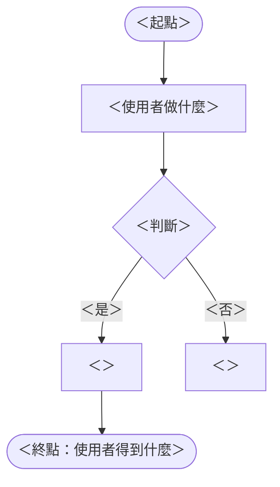

# 02 PRD —— ＜專案名稱＞

> **為誰做、做什麼、怎麼算做對了。** 上游：`01-brief.md`。範例：`examples/it-asset/02-prd.md`。
>
> ⚠️ 這份**不寫技術名詞**（框架、資料表、API）。寫得出 Given / When / Then 的才是驗收條件。
>
> **規模上限（2 天課）**：story ≤ 6、AC 總數 ≤ 15。彩排時 agent 自己長出 9 個 story、32 條 AC，
> 往下會變成 37 條 FR、55 個測試案例 —— 人審不完。超過的放進 01 的 non-goal 或「待決事項」。

| 項目 | 內容 |
|---|---|
| 版本 | ＜v0.1＞ |
| 上游 | `01-brief.md` ＜v0.1＞ |
| 最後更新 | ＜YYYY-MM-DD＞ |

---

## 1. Persona

> 💡 2–3 個就夠。寫行為與處境，不寫年齡星座。每個 persona 至少要有一個 story。

| 編號 | 是誰 | 處境與習慣 | 最怕什麼 |
|---|---|---|---|
| P-01 | ＜＞ | ＜＞ | ＜＞ |
| P-02 | | | |

---

## 2. User Flow

> 💡 主流程從「打開」到「達成目的」，用使用者的動作寫，不超過 10 步。分支只畫會改變結果的那幾個（失敗、要追問、被駁回）。

---

## 3. Epic 與 User Story

> 💡 Epic 對到 Brief 的 goal；story 寫「身為／我想要／以便」。編號發出去就凍結，後面的 SRS、測試都會引用。

### EP-01 ＜epic 名稱＞（對應 G-01）

| 編號 | 身為 | 我想要 | 以便 | 優先 |
|---|---|---|---|---|
| US-01 | P-01 | ＜＞ | ＜＞ | 必要 |
| US-02 | | | | |

### EP-02 ＜epic 名稱＞（對應 G-02）

| 編號 | 身為 | 我想要 | 以便 | 優先 |
|---|---|---|---|---|
| US-03 | | | | |

---

## 4. 驗收條件（BDD）

> 💡 每個 story 至少 2 條，其中至少一條是失敗或例外路徑。日期、數字、訊息文字寫具體。
> 交給一個沒參加討論的人，他要判斷得出「過了沒」。寫不出具體數字的，移到「待決事項」。

### US-01 ＜story 標題＞

- **AC-01.1** Given ＜具體狀態，含數字＞ When ＜使用者做什麼＞ Then ＜看得到的結果，含數字或文字＞
- **AC-01.2** Given ＜＞ When ＜＞ Then ＜＞

### US-02 ＜story 標題＞

- **AC-02.1** Given ＜＞ When ＜＞ Then ＜＞

---

## 5. AI 的角色與限制

> 💡 系統裡有 AI 功能時必填。

| AI 可以 | AI 不可以 |
|---|---|
| ＜例：把一句話轉成草稿＞ | ＜例：核准、計算額度、改狀態＞ |

**AI 出錯時使用者怎麼辦**：＜例：草稿一定先給使用者看、可以修改，確認後才送出＞

---

## 6. 待決事項

| 編號 | 問題 | 誰決定 | 什麼情況下會知道答案 |
|---|---|---|---|
| Q-01 | ＜＞ | ＜＞ | ＜觸發條件，不是「之後再說」＞ |

---

## 通過檢核

- [ ] story ≤ 6、AC ≤ 15
- [ ] User flow 在 Mermaid 預覽裡畫得出來
- [ ] 每個 epic 都標了對應的 G；每個 story 都標了 persona
- [ ] 每個 story 至少 2 條 AC，至少一條是失敗路徑
- [ ] AC 裡沒有「正確」「合理」「適當」「友善」這類判斷不了的字
- [ ] 整份沒有技術名詞
