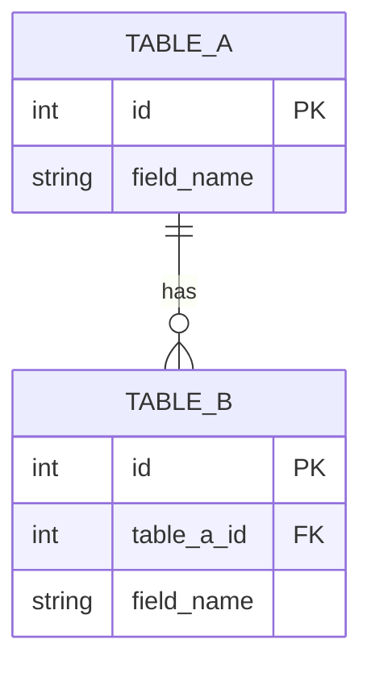

# 05 SDS —— ＜專案名稱＞

> **每一塊怎麼做。** 細到 agent 可以照著寫程式、你可以照著驗收。上游：`04-sad.md`。範例：`examples/it-asset/05-sds.md`。

| 項目 | 內容 |
|---|---|
| 版本 | ＜v0.1＞ |
| 上游 | `04-sad.md` ＜v0.1＞ |
| 最後更新 | ＜YYYY-MM-DD＞ |

---

## 1. ER Model

> 💡 只畫這一版需要的表。名稱只用英文、數字、底線。欄位名稱要跟 API 的欄位一致。

| 表 | 欄位 | 型別 | 允許的值 / 預設 | 對應需求 |
|---|---|---|---|---|
| ＜＞ | ＜＞ | ＜＞ | ＜＞ | ＜FR-02＞ |

---

## 2. API 規格

> 💡 每支 API 都寫錯誤情況 —— 只寫成功路徑，AI 會自己發明錯誤處理。路徑一律在 `/api` 底下。
> 做進階挑戰 C4 時，解析 API `POST /api/parse` 的形狀由 `STACK.md` 固定，照抄，不要改。

### API-01 `＜METHOD＞ /api/＜path＞`

| 項目 | 內容 |
|---|---|
| 用途 | ＜例：送出一張請假申請＞ |
| 對應需求 | ＜FR-01、FR-02＞ |
| Request | ＜例：`{"employee_id": int, "leave_type": "annual", "start_date": "YYYY-MM-DD", …}`＞ |
| Response 201 | ＜＞ |

| 錯誤情況 | 狀態碼 | 回傳 |
|---|---|---|
| ＜例：必填欄位缺漏＞ | ＜422＞ | ＜`{"error": "…"}`，訊息文字寫出來＞ |
| ＜例：結束日期早於開始日期＞ | ＜422＞ | ＜＞ |

### API-02 `＜METHOD＞ /api/＜path＞`

| 項目 | 內容 |
|---|---|
| 用途 | ＜例：列出某位員工的假單＞ |
| 對應需求 | ＜＞ |
| Request | ＜＞ |
| Response 200 | ＜＞ |

| 錯誤情況 | 狀態碼 | 回傳 |
|---|---|---|
| ＜＞ | ＜＞ | ＜＞ |

---

## 3. 畫面

> 💡 每個畫面：誰用、顯示什麼、能做什麼、呼叫哪支 API。對到 PRD 的 user flow。

| 編號 | 畫面 | 誰用 | 顯示 | 動作 → API | 對應需求 |
|---|---|---|---|---|---|
| UI-01 | ＜＞ | ＜P-01＞ | ＜＞ | ＜按「送出」→ API-02＞ | ＜US-01＞ |

---

## 4. 模組與介面

> 💡 後端拆成哪些模組、各自對外提供什麼函式。**驗證與計算放在一個不碰 HTTP、不碰資料庫的模組**，單元測試才能直接呼叫。做 C4 時，AI 的部分再獨立成一個模組。

| 模組 | 負責 | 對外介面（簽名） | 對應需求 |
|---|---|---|---|
| ＜例：rules＞ | ＜驗證欄位與日期、計算天數＞ | ＜`leave_days(start: date, end: date, period: str) -> float`＞ | ＜FR-02、FR-03＞ |
| ＜例：repository＞ | ＜存取 SQLite＞ | ＜＞ | ＜FR-04＞ |

**今天是幾號**：＜例：`clock.today()` 讀 `LEAVEBOT_TODAY`（見 `STACK.md`），測試注入固定日期＞

**資料庫放哪裡**：＜例：讀 `LEAVEBOT_DB`（見 `STACK.md`），測試用暫存檔＞

**（C4 才填）給 LLM 的 prompt 放哪裡、輸出怎麼驗證**：＜例：prompt 放 `backend/app/prompts.py`；輸出用 pydantic model 驗證，失敗回 422＞

---

## 通過檢核

- [ ] ER 圖在 Mermaid 預覽裡畫得出來，每張表都對到需求
- [ ] 每支 API 都有對應需求與錯誤情況；API 欄位、ER 欄位、需求編號三者一致
- [ ] 每個畫面都對到 PRD user flow 的某一步
- [ ] 驗證與計算在一個不碰 HTTP、不碰資料庫的模組
