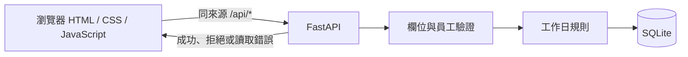

# 04 SAD — LeaveBot

> 上游：`docs/02-prd.md`、`docs/03-srs.md`；技術邊界依 `course/01-上課/04-STACK.md`。

文件狀態：已確認；負責人／審查者：LeaveBot 小組。適用環境：本機單服務。

## 情境與品質驅動

員工送出假單後必須得到可信的回饋，重新整理仍能核對紀錄。核心風險是無效輸入被存檔、天數算錯，以及所選員工列表混入其他人的資料（FR-01 至 FR-06）。理由須安全呈現，測試資料須與開發資料隔離（NFR-01、NFR-02）。

## 元件與資料流

卡 D 的 [送出流程圖](../diagrams/submit-leave.html)另外呈現成功、拒絕且不存檔、更新個人列表的分支。沒有外部模型、登入或額度服務。

瀏覽器收集輸入，FastAPI 重驗後交由規則函式計算，再寫入 SQLite；只有 API 確認成功，瀏覽器才顯示已送出。責任與故障回饋對照如下：

| 元件 | 責任／擁有資料 | 失敗時怎麼處理 |
|---|---|---|
| 瀏覽器 | 收集表單、顯示回饋和所選員工列表；理由用純文字呈現 | API 拒絕時顯示錯誤；提交期間停用按鈕 |
| FastAPI | 驗證輸入、決定 `days` 與 `status`；FR-01、FR-02、FR-05 | 無效輸入回 422，未知查詢員工回 404；拒絕時不寫資料 |
| `rules.leave_days` | 計算工作日與半天；FR-03 | 非法組合由 API 轉為 422 |
| SQLite 接縫 | 初始化員工、保存與查詢假單；FR-01、FR-06 | 例外時 rollback 並關閉連線，不回報成功 |

## 重要決策與取捨

沿用 STACK 的 FastAPI、靜態頁與 SQLite；沒有需要額外 ADR 的新技術選型。員工由下拉選單而非登入識別，是本版的範圍限制，不提供操作人身分驗證。

## 運作、風險與未決

瀏覽器到 FastAPI 是不可信輸入邊界；後端重驗員工、假別、日期、時段、理由，並自行決定 `days` 與 `status`。SQL 以參數處理，理由只以純文字顯示。SQLite 寫入以單次交易處理，失敗 rollback；前端以 API 真實回應決定成功或錯誤，不以按下按鈕當成功證據。

本機可從 `LEAVEBOT_DB` 切換資料庫，測試用暫存庫隔離。本版沒有部署、備份、監控與恢復演練；若要開放正式使用，身分與授權、資料保護、遷移／備份、錯誤監測和回退須另立需求。
