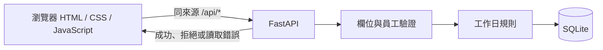

# 04 SAD — LeaveBot（講師參考）

> 上游：`docs/02-prd.md`、`docs/03-srs.md`；技術邊界依 `course/01-上課/04-STACK.md`。

文件狀態：講師參考已確認；負責人／審查者：課程講師。適用環境：本機課堂，無正式部署。

## 系統圖

卡 D 的 [送出流程圖](../diagrams/submit-leave.html)另外呈現成功、拒絕且不存檔、更新個人列表的分支。沒有外部模型、登入或額度服務。

## 模組責任與失敗

瀏覽器負責收集表單、顯示回饋與所選員工列表。它使用相對 `/api` 路徑，並以純文字呈現理由；API 拒絕時顯示錯誤，不宣稱成功。提交期間按鈕停用。

- **FastAPI：**重驗欄位、員工、假別與日期，不信任客戶端的 `days`／`status`。無效輸入回 422，未知查詢員工回 404；拒絕時不寫資料庫。
- **`rules.leave_days`：**計算工作日與半天，非法組合交由 API 轉為 422。
- **SQLite 接縫：**初始化員工、保存和查詢假單，以 `create_app(database_path)` 注入測試資料庫；發生例外時 rollback 並關閉連線，不回報虛假的成功。

## 必要取捨

沿用 STACK 的 FastAPI、靜態頁與 SQLite；此階段沒有需要額外 ADR 的新技術選型。員工由下拉選單而非登入識別，是本課基本範圍的刻意限制，不提供真實身分驗證。

## 信任邊界、故障與運作範圍

瀏覽器到 FastAPI 是不可信輸入邊界；後端重驗員工、假別、日期、時段、理由，並自行決定 `days` 與 `status`。SQL 以參數處理，理由只以純文字顯示。SQLite 寫入以單次交易處理，失敗 rollback；前端以 API 真實回應決定成功或錯誤，不以按下按鈕當成功證據。

本機可從 `LEAVEBOT_DB` 切換資料庫，測試用暫存庫隔離。課堂沒有部署、備份、監控與恢復演練；若要上線，身分與授權、資料保護、遷移／備份、錯誤監測和回退須另立需求。此處不聲稱符合正式服務的可靠性或隱私標準。
