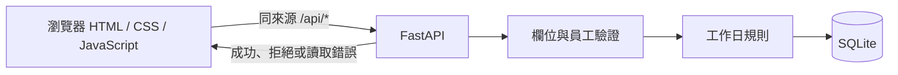

# 04 SAD — LeaveBot（講師參考）

> 上游：`docs/02-prd.md`、`docs/03-srs.md`；技術邊界依 `course/01-上課/04-STACK.md`。

## 系統圖

卡 D 的 [送出流程圖](../diagrams/submit-leave.html)另外呈現成功、拒絕且不存檔、更新個人列表的分支。沒有外部模型、登入或額度服務。

## 模組責任與失敗

| 元件 | 責任 | 失敗路徑 |
|---|---|---|
| 瀏覽器頁面 | 選員工、收集表單、顯示回饋與個人列表；使用相對 `/api` 與純文字呈現理由 | API 拒絕時顯示錯誤，不宣稱成功；提交期間停用按鈕 |
| FastAPI | 驗證欄位、假別、日期及員工；不信任客戶端的 `days`／`status` | 無效輸入回 422、未知查詢員工回 404；拒絕時不寫資料庫 |
| `rules.leave_days` | 算工作日與半天，拒絕非法日期組合 | 規則錯誤由 API 轉為 422 |
| SQLite 接縫 | 初始化員工、保存假單、依員工查詢；以 `create_app(database_path)` 注入測試資料庫 | 例外時交易 rollback 並關閉連線；不回報虛假的成功 |

## 必要取捨

沿用 STACK 的 FastAPI、靜態頁與 SQLite；此階段沒有需要額外 ADR 的新技術選型。員工由下拉選單而非登入識別，是本課基本範圍的刻意限制，不提供真實身分驗證。
