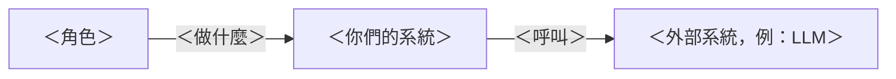
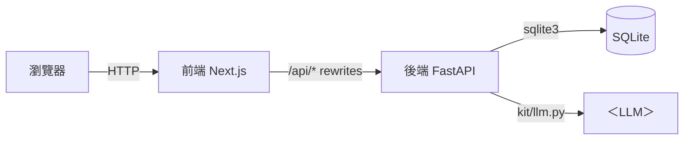
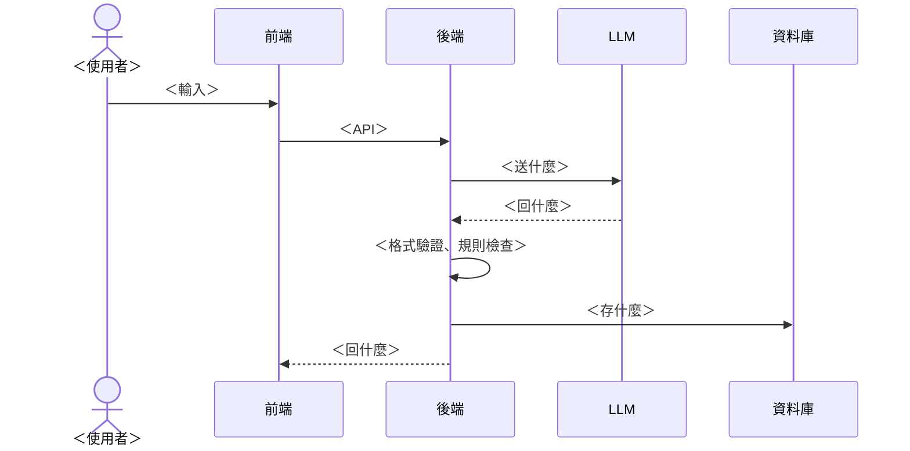

# 04 SAD —— ＜專案名稱＞

> **系統怎麼組起來。** 元件、資訊怎麼流、誰負責什麼、做了哪些選擇。上游：`03-srs.md`。範例：`examples/it-asset/04-sad.md`。
>
> 技術棧已經由 `STACK.md` 固定。這份寫的是**在那個邊界之內**你們做的決定。

| 項目 | 內容 |
|---|---|
| 版本 | ＜v0.1＞ |
| 上游 | `03-srs.md` ＜v0.1＞ |
| 最後更新 | ＜YYYY-MM-DD＞ |

---

> 💡 Mermaid：連線標籤或節點文字裡有括號、冒號、斜線時，用雙引號包起來（`-->|"build_llm()"|`），否則整張圖畫不出來。

## 1. C4 Level 1：系統情境

> 💡 一個方框是你們的系統，周圍是使用者與外部系統。只畫會跨過邊界的東西。

---

## 2. C4 Level 2：容器

> 💡 拆成可以各自部署 / 執行的單元：前端、後端、資料庫、外部服務。標出它們之間用什麼溝通。

---

## 3. 資訊流

> 💡 挑最重要的一條路徑，畫成循序圖：資料從哪裡進來、經過誰、在哪裡被驗證、在哪裡被存起來、最後回到誰手上。
> 有 AI 的系統，**一定要畫出「AI 的輸出在哪裡被驗證」**。

---

## 4. 誰負責什麼

> 💡 口訣：錯了會有人受傷 → 程式碼或人；規則寫不完、錯了能補救 → AI。

| 工作 | 負責 | 理由 | 對應需求 |
|---|---|---|---|
| ＜＞ | 🤖 AI | ＜＞ | ＜FR-01＞ |
| ＜＞ | 📏 程式碼 | ＜＞ | ＜FR-03＞ |
| ＜＞ | 👤 人 | ＜＞ | ＜FR-05＞ |

---

## 5. 技術選型（ADR）

> 💡 一個決定一列：選了什麼、放棄了什麼、為什麼、可不可逆。`STACK.md` 已固定的不用重寫，寫你們在它之內的選擇
> （例：AI 一次解析整句還是分段、草稿存不存資料庫、狀態用幾個值）。

| 編號 | 決定 | 放棄的選項 | 理由 | 可逆嗎 | 對應需求 |
|---|---|---|---|---|---|
| ADR-01 | ＜＞ | ＜＞ | ＜＞ | ＜可逆 / ⚠️ 不可逆＞ | ＜＞ |
| ADR-02 | | | | | |

---

## 6. 安全與紅線

| 紅線 | 用什麼擋 | 對應需求 |
|---|---|---|
| ＜例：AI 不能改狀態＞ | ＜例：AI 輸出的 schema 沒有狀態欄位，存檔前驗證＞ | ＜NFR-02＞ |

> 💡 「用什麼擋」不能填「在 prompt 裡叫它不要」—— 那是建議，不是防線。

---

## 通過檢核

- [ ] 三張圖（C4 L1、L2、資訊流）都在 Mermaid 預覽裡畫得出來
- [ ] 資訊流裡看得到 AI 輸出被驗證的位置
- [ ] 剩餘額度、核准這類會讓人受傷的工作，不是 AI 負責
- [ ] 至少 2 條 ADR，每條寫了放棄的選項
